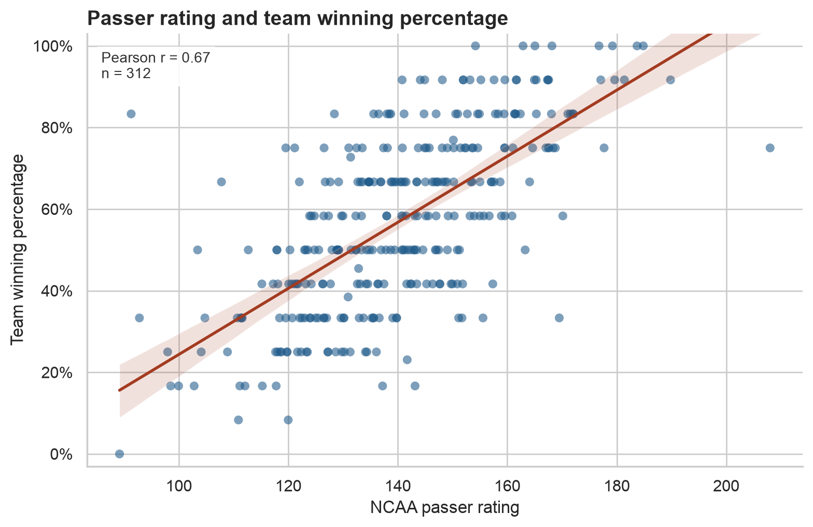
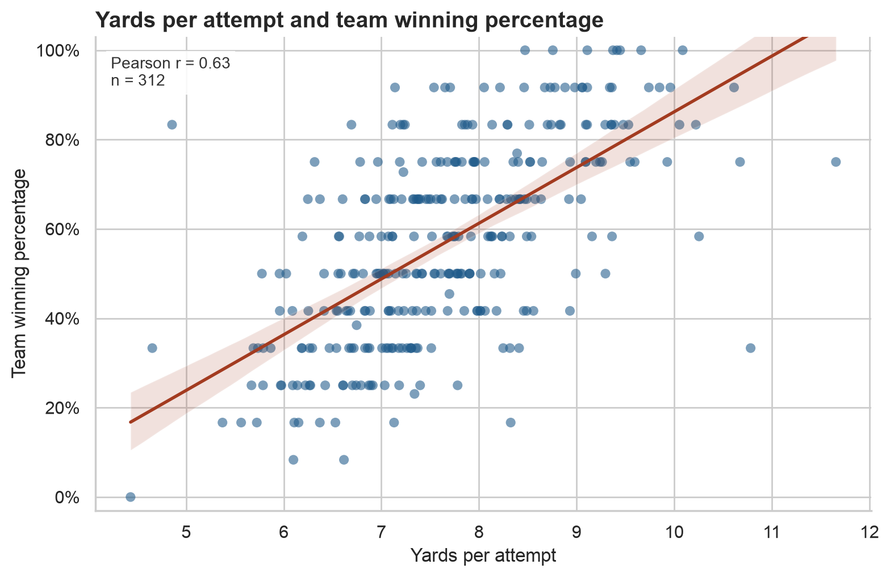
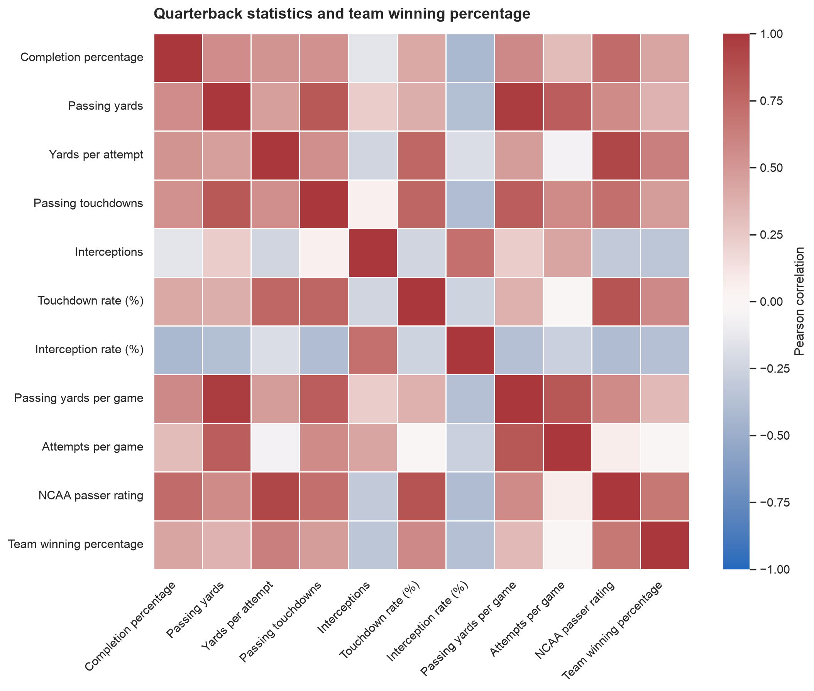

## Why compare quarterbacks and wins?

Quarterbacks get a lot of credit when their teams win and a lot of blame when they lose. Passing totals do not always tell the same story. A quarterback can pile up yards in a good offense, but he can also pile up yards because his team is behind and has to throw on nearly every play.

I wanted to know how strongly quarterback passing performance is associated with team success in FBS college football. I compared each team's primary passer with the team's winning percentage over three seasons. The results suggest that how well a quarterback uses his attempts matters much more than how often he throws.

## How I collected the data

I collected the data from the authenticated [CollegeFootballData API](https://collegefootballdata.com/) instead of scraping webpages. The API key was stored in a local `.env` file that Git ignored. The script loaded the key and sent it in the Bearer authorization header, so the credential never appeared in the code, request URLs, or public repository.

The collection process was repeated for 2023, 2024, and 2025. First, the script requested that season's FBS membership from `/teams/fbs`. Using a separate list for each year mattered because FBS membership changed during this period. Next, it requested completed regular season games from `/games`. Games had to involve an FBS program and have a final score. Conference championship games were identified from the game notes and removed. Games with playoff metadata were also removed, which kept bowls and College Football Playoff games out of the sample. The script was set to stop if it found a tie rather than deciding how to count it after the fact.

Player statistics came from `/games/players`, requested one week at a time. For each included game, I kept completions, attempts, passing yards, touchdowns, and interceptions. I did not use sacks. CFBD game and team identifiers connected each box score to the correct game result.

Once the game level data were collected, the script added each passer's statistics within a team and season. The player with the most attempts became that team's primary quarterback. He also needed a passing box score entry in at least 10 included games. Wins and losses came from those same games, so the passing statistics and team record covered the same part of the season.

All rates were calculated from the collected totals rather than copied from the API. That includes completion percentage, yards per attempt, touchdown and interception rates, per game measures, winning percentage, and NCAA passer efficiency. Using $Y$ for yards, $TD$ for touchdowns, $C$ for completions, $INT$ for interceptions, and $A$ for attempts, the rating is

$$
\text{Rating} = \frac{8.4Y + 330TD + 100C - 200INT}{A}.
$$

The script cached API responses in `.cache/cfbd`. Later runs could reuse a saved response instead of spending API quota on the same request. Timeouts, limited retries, and a short delay between calls also kept the collection process from putting unnecessary traffic on the API. The full script and validation files are in the [project repository](https://github.com/ggjas111024/jgibb-cfb-qb-data).

## The dataset

The final dataset has 312 quarterback team seasons: 98 from 2023, 107 from 2024, and 107 from 2025. It includes 219 quarterbacks and 136 teams. There are no missing values. The 10 game rule removed 91 team seasons, and the game filters removed 28 conference championships. The final data contain no ties or sack fields.

The average quarterback completed 62.76% of his passes and gained 7.65 yards per attempt. The average touchdown rate was 5.44%, the average interception rate was 2.40%, and the average NCAA passer rating was 140.15. Teams won 56.89% of their included games on average.

## Efficiency had the strongest relationship

NCAA passer rating had the largest correlation with winning percentage, with Pearson's $r = 0.6695$. Higher ratings usually went with better records, although the points are spread widely enough to show plenty of exceptions.

{#fig-rating fig-alt="Scatterplot of NCAA passer rating against team winning percentage for 312 quarterback team seasons. Points trend upward around a fitted regression line; Pearson r equals 0.67."}

Yards per attempt had a similar relationship with winning, with **$r = 0.6324$**. Unlike total yards, this measure accounts for how many throws it took to gain those yards.

{#fig-ypa fig-alt="Scatterplot of yards per pass attempt against team winning percentage. The points and fitted line show a positive relationship; Pearson r equals 0.63."}

The other correlations followed the same pattern:

| Passing measure | Pearson correlation with win percentage |
|---|---:|
| NCAA passer rating | 0.6695 |
| Yards per attempt | 0.6324 |
| Touchdown rate | 0.5726 |
| Completion percentage | 0.4330 |
| Passing yards | 0.3636 |
| Interception rate | -0.3684 |
| Attempts per game | -0.0195 |

Touchdown rate and completion percentage were positively associated with winning, while interception rate was negatively associated with it. Total passing yards had a smaller correlation than the efficiency measures. Attempts per game was almost unrelated to winning at $r = -0.0195$. Throwing more often is not automatically a sign of a better offense. It may simply mean that a team spent more time trying to come back from a deficit.

{#fig-heatmap fig-alt="Correlation heatmap for quarterback passing statistics and team winning percentage. Efficiency metrics are more positively correlated with winning than attempts per game."}

## What the correlations cannot show

This analysis does not prove that efficient quarterback play causes teams to win. Defense, schedule strength, coaching, injuries, offensive scheme, and game situation can affect both passing numbers and team records. A good running game can create easier passing opportunities. A poor defense can force an offense to throw from behind.

The 10 game cutoff also leaves out some injury heavy seasons and quarterback rotations. Choosing one primary quarterback makes team seasons easier to compare, but it does not describe every team's situation perfectly.

Over these three seasons, teams with efficient primary quarterbacks generally won more often. Passer rating and yards per attempt had the clearest relationships with winning, while attempts per game had almost none. A useful next step would be to include schedule strength, defense, and game situation and see how much of the relationship remains.

## Further resources

- [CollegeFootballData](https://collegefootballdata.com/) provides API access and current usage information.
- The [project repository](https://github.com/ggjas111024/jgibb-cfb-qb-data) contains the collection code, validation rules, data, and analysis.
- The [pandas GroupBy guide](https://pandas.pydata.org/docs/user_guide/groupby.html) explains the grouping operations used to build team season totals.

